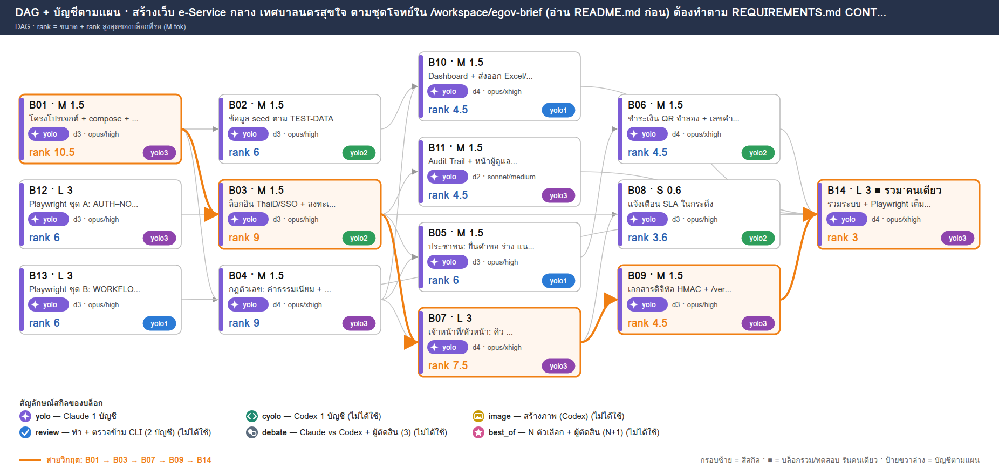
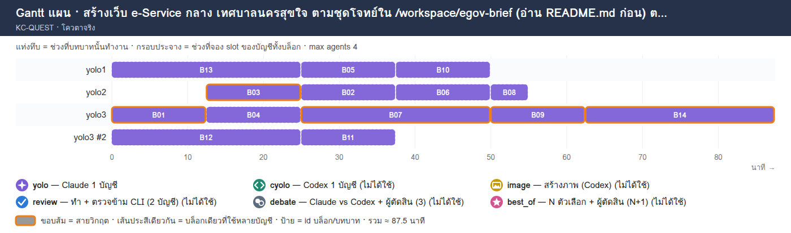

# PLAN · egov-eservice

**โจทย์:** สร้างเว็บ e-Service กลาง เทศบาลนครสุขใจ ตามชุดโจทย์ใน /workspace/egov-brief (อ่าน README.md ก่อน) ต้องทำตาม REQUIREMENTS.md CONTRACT.md TEST-DATA.md DECISIONS.md ครบทุกข้อ (route · data-testid · ข้อความ error ตรงตัวอักษร · API · test hook) รันด้วย docker compose up คำสั่งเดียว รองรับ TEST_MODE=1 และ BUG_MODE=B01..B12 ตาม BUGS.md (ไม่ตั้ง = เว็บถูกต้อง 100%) และมีชุด Playwright ครบ 51 TC ใน TEST-PLAN.md · stack: Node 20 + Express + SQLite (better-sqlite3) + หน้า HTML render ฝั่งเซิร์ฟเวอร์ · เวลาในกฎธุรกิจอ่านจากนาฬิกาทดสอบ (Asia/Bangkok) ห้ามเรียกเวลาเครื่องตรง ๆ · ห้ามใช้ชื่อ/ตราหน่วยงานจริง ห้ามเชื่อมระบบจริง · ข้อมูลทดสอบเป็นข้อมูลสมมติเท่านั้น

วางแผนเมื่อ 2026-11-17 13:45:38 · โควตาจริง (team.py quota --json) · ความพร้อม: team.py check --json · max agents 4 · แผนนี้ยังไม่ได้รันจริง (KC-QUEST จำลองเวลา)

## 1) บัญชีและโควตา

| บัญชี | ฝั่ง | ใช้ไป 5 ชม. | ใช้ไปสัปดาห์ | headroom | slot | เหลือหลังแผน (5ชม./สัปดาห์) | หมายเหตุ |
|---|---|---|---|---|---|---|---|
| yolo1 | yolo | 19% | 3% | 81.0% | 3 | 65.4% / 95.04% | จริง @2026-11-17T13:45 |
| yolo2 | yolo | 19% | 3% | 81.0% | 3 | 67.7% / 95.33% | จริง @2026-11-17T13:45 |
| yolo3 | yolo | 5% | 0% | 95.0% | 3 | 56.0% / 95.1% | จริง @2026-11-17T13:45 |

## 2) DAG

**สายวิกฤต:** B01 → B03 → B07 → B09 → B14 · ยาว 10.5M tok

## 3) ตารางแจกงาน + เหตุผล KC-QUEST

| บล็อก | ชื่อ | สกิล | ขนาด·c | รอ | rank | บัญชี | นาที | เหตุผล KC-QUEST (คะแนน U F R V L) |
|---|---|---|---|---|---|---|---|---|
| **B01** | โครงโปรเจกต์ + compose + DB + test hook | yolo | M·1.5 | – | 10.5 | yolo3 | 0.0–12.5 | ผู้ทำ: yolo3 36.7 (U=0.198 F=0.005 S=0.911 S=1.0 L=0.0) · 1.50M tok ≈ 5ชม. 3.9% / สัปดาห์ 0.49% · อันดับ 2 yolo1 32.7 |
| B12 | Playwright ชุด A: AUTH–NOTI (22 TC) | yolo | L·3 | – | 6 | yolo3 | 0.0–25.0 | ผู้ทำ: yolo3 25.9 (U=0.198 F=0.01 S=0.833 S=0.571 L=0.333) · 3.00M tok ≈ 5ชม. 7.8% / สัปดาห์ 0.98% · อันดับ 2 yolo1 25.7 |
| B13 | Playwright ชุด B: WORKFLOW–NFR (29 TC) | yolo | L·3 | – | 6 | yolo1 | 0.0–25.0 | ผู้ทำ: yolo1 25.7 (U=0.15 F=0.01 S=0.732 S=0.571 L=0.0) · 3.00M tok ≈ 5ชม. 7.8% / สัปดาห์ 0.98% · อันดับ 2 yolo2 25.7 |
| **B03** | ล็อกอิน ThaiD/SSO + ลงทะเบียน + RBAC | yolo | M·1.5 | B01 | 9 | yolo2 | 12.5–25.0 | ผู้ทำ: yolo2 30.5 (U=0.15 F=0.005 S=0.771 S=0.857 L=0.0) · 1.50M tok ≈ 5ชม. 3.9% / สัปดาห์ 0.49% · อันดับ 2 yolo3 29.5 |
| B04 | กฎตัวเลข: ค่าธรรมเนียม + SLA วันทำการ + ระดับเตือน | yolo | M·1.5 | B01 | 9 | yolo3 | 12.5–25.0 | ผู้ทำ: yolo3 29.5 (U=0.198 F=0.005 S=0.794 S=0.857 L=0.333) · 1.50M tok ≈ 5ชม. 3.9% / สัปดาห์ 0.49% · อันดับ 2 yolo2 26.6 |
| **B07** | เจ้าหน้าที่/หัวหน้า: คิว รับเรื่อง ตีกลับ อนุมัติ + PDPA | yolo | L·3 | B03, B04 | 7.5 | yolo3 | 25.0–50.0 | ผู้ทำ: yolo3 29.6 (U=0.198 F=0.01 S=0.716 S=0.714 L=0.0) · 3.00M tok ≈ 5ชม. 7.8% / สัปดาห์ 0.98% · อันดับ 2 yolo2 27.3 |
| B02 | ข้อมูล seed ตาม TEST-DATA | yolo | M·1.5 | B01 | 6 | yolo2 | 25.0–37.5 | ผู้ทำ: yolo2 25.6 (U=0.15 F=0.005 S=0.732 S=0.571 L=0.0) · 1.50M tok ≈ 5ชม. 3.9% / สัปดาห์ 0.49% · อันดับ 2 yolo1 25.1 |
| B05 | ประชาชน: ยื่นคำขอ ร่าง แนบไฟล์ ยกเลิก | yolo | M·1.5 | B03, B04 | 6 | yolo1 | 25.0–37.5 | ผู้ทำ: yolo1 25.1 (U=0.15 F=0.005 S=0.693 S=0.571 L=0.0) · 1.50M tok ≈ 5ชม. 3.9% / สัปดาห์ 0.49% · อันดับ 2 yolo3 23.4 |
| B11 | Audit Trail + หน้าผู้ดูแลระบบ | yolo | M·1.5 | B03 | 4.5 | yolo3 | 25.0–37.5 | ผู้ทำ: yolo3 21.3 (U=0.198 F=0.005 S=0.677 S=0.429 L=0.333) · 1.50M tok ≈ 5ชม. 3.9% / สัปดาห์ 0.49% · อันดับ 2 yolo2 19.6 |
| B06 | ชำระเงิน QR จำลอง + เลขคำขอ + ใบเสร็จ | yolo | M·1.5 | B05 | 4.5 | yolo2 | 37.5–50.0 | ผู้ทำ: yolo2 22.9 (U=0.15 F=0.005 S=0.693 S=0.429 L=0.0) · 1.50M tok ≈ 5ชม. 3.9% / สัปดาห์ 0.49% · อันดับ 2 yolo1 22.3 |
| B10 | Dashboard + ส่งออก Excel/PDF | yolo | M·1.5 | B02, B04 | 4.5 | yolo1 | 37.5–50.0 | ผู้ทำ: yolo1 22.3 (U=0.15 F=0.005 S=0.654 S=0.429 L=0.0) · 1.50M tok ≈ 5ชม. 3.9% / สัปดาห์ 0.49% · อันดับ 2 yolo3 20.7 |
| **B09** | เอกสารดิจิทัล HMAC + /verify | yolo | M·1.5 | B07 | 4.5 | yolo3 | 50.0–62.5 | ผู้ทำ: yolo3 24.0 (U=0.198 F=0.005 S=0.638 S=0.429 L=0.0) · 1.50M tok ≈ 5ชม. 3.9% / สัปดาห์ 0.49% · อันดับ 2 yolo2 22.3 |
| B08 | แจ้งเตือน SLA ในกระดิ่ง | yolo | S·0.6 | B07 | 3.6 | yolo2 | 50.0–55.0 | ผู้ทำ: yolo2 21.3 (U=0.15 F=0.002 S=0.677 S=0.343 L=0.0) · 0.60M tok ≈ 5ชม. 1.56% / สัปดาห์ 0.2% · อันดับ 2 yolo1 20.8 |
| **B14** | รวมระบบ + Playwright เต็ม + BUG_MODE ×12 | yolo | L·3 | B06, B08, B09, B10, B11, B12, B13 | 3 | yolo3 | 62.5–87.5 | ผู้ทำ: yolo3 20.8 (U=0.198 F=0.01 S=0.56 S=0.286 L=0.0) · 3.00M tok ≈ 5ชม. 7.8% / สัปดาห์ 0.98% · อันดับ 2 yolo2 19.5 |

## 4) Gantt

## 5) รอบแจกงาน

| นาทีที่ | บล็อกที่เริ่ม |
|---|---|
| 0.0 | B01→yolo3, B12→yolo3, B13→yolo1 |
| 12.5 | B03→yolo2, B04→yolo3 |
| 25.0 | B07→yolo3, B02→yolo2, B05→yolo1, B11→yolo3 |
| 37.5 | B06→yolo2, B10→yolo1 |
| 50.0 | B09→yolo3, B08→yolo2 |
| 62.5 | B14→yolo3 |

## 6) สรุป

- รวม ≈ **88 นาที** · worker พร้อมกันสูงสุด 4
- ตัวปรับเวลา k (จาก run ก่อน): ยังไม่มี (1.0)
- ขั้นต่อไป: `dagplan.py export egov-eservice` → `dagplan.py run egov-eservice` (ใช้โทเคนจริง ทำเมื่อผู้ใช้สั่ง)
