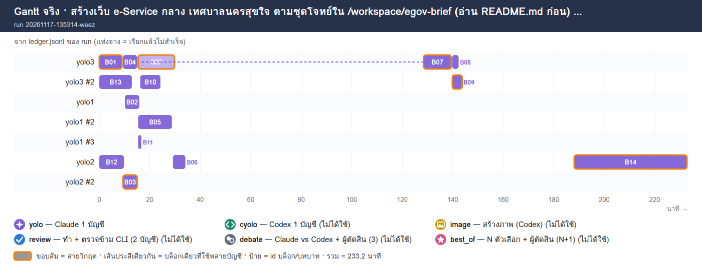
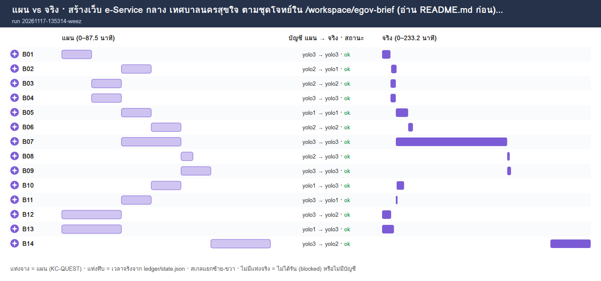

# REPORT · egov-eservice

**run:** `20261117-135314-weez` · run dir `/workspace/.agent-team/20261117-135314-weez`

| บล็อก | สกิล | บัญชีแผน | บัญชีจริง | นาทีแผน | นาทีจริง | calls | input | output | tokens* | สถานะ |
|---|---|---|---|---|---|---|---|---|---|---|
| B01 | yolo | yolo3 | yolo3 | 12.5 | 9.383 | 1 | 60 | 51046 | 185002 | ok |
| B02 | yolo | yolo2 | yolo1 | 12.5 | 6.100 | 1 | 42 | 45135 | 171886 | ok |
| B03 | yolo | yolo2 | yolo2 | 12.5 | 5.983 | 1 | 56 | 36174 | 171740 | ok |
| B04 | yolo | yolo3 | yolo3 | 12.5 | 5.950 | 1 | 40 | 37935 | 149009 | ok |
| B05 | yolo | yolo1 | yolo1 | 12.5 | 13.767 | 1 | 102 | 82101 | 368562 | ok |
| B06 | yolo | yolo2 | yolo2 | 12.5 | 5.333 | 1 | 56 | 31306 | 183024 | ok |
| B07 | yolo | yolo3 | yolo3 | 25.0 | 124.450 | 2 | 166 | 113113 | 560700 | ok |
| B08 | yolo | yolo2 | yolo3 | 5.0 | 2.883 | 1 | 38 | 12646 | 85719 | ok |
| B09 | yolo | yolo3 | yolo3 | 12.5 | 4.283 | 1 | 46 | 20257 | 133009 | ok |
| B10 | yolo | yolo1 | yolo3 | 12.5 | 8.400 | 1 | 84 | 49314 | 213034 | ok |
| B11 | yolo | yolo3 | yolo1 | 12.5 | 1.683 | 1 | 16 | 15047 | 75826 | ok |
| B12 | yolo | yolo3 | yolo2 | 25.0 | 10.133 | 1 | 40 | 73414 | 238769 | ok |
| B13 | yolo | yolo1 | yolo3 | 25.0 | 13.283 | 1 | 40 | 96607 | 302919 | ok |
| B14 | yolo | yolo3 | yolo2 | 25.0 | 45.067 | 1 | 28 | 19037 | 42367 | ok |

\* tokens = input (ไม่รวม cache read) + cache_write + output ตามกติกา ledger ของ agent-team · รวม 2881566

สถานะ: ok=14

## การย้ายบัญชี (failover ของ agent-team)

| บล็อก | จาก | ไป | เหตุผล |
|---|---|---|---|
| B08 | yolo1 | yolo2 | บัญชี yolo1 หยุดรับงาน: โควตา 82% ≥ เกณฑ์ 80% |
| B14 | yolo1 | yolo2 | บัญชี yolo1 หยุดรับงาน: โควตา 82% ≥ เกณฑ์ 80% |

## ตัวปรับเวลา k (KC-QUEST ⑥ เรียนรู้)

| สกิล | จริง÷แผน | k ใหม่ | บล็อก |
|---|---|---|---|
| yolo | 1.18 | 1.18 | B01, B02, B03, B04, B05, B06, B07, B08, B09, B10, B11, B12, B13, B14 |

บันทึกที่ `/workspace/plans/calib.json` · `plan` ครั้งถัดไปคูณเวลาด้วย k ของสกิล

## ภาพ

